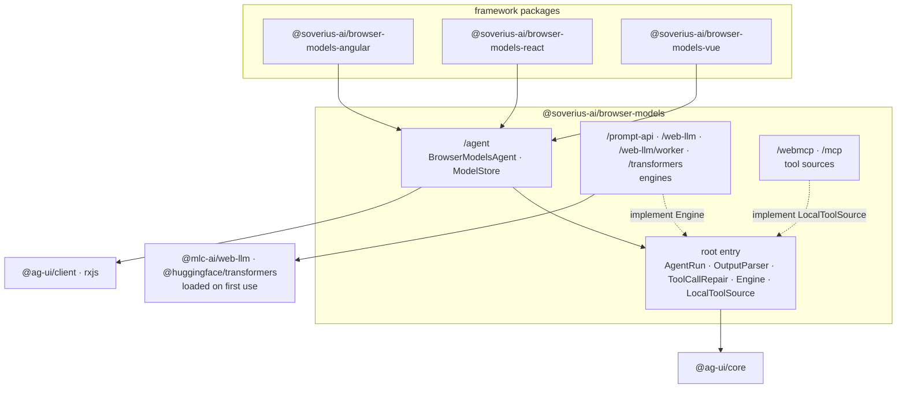
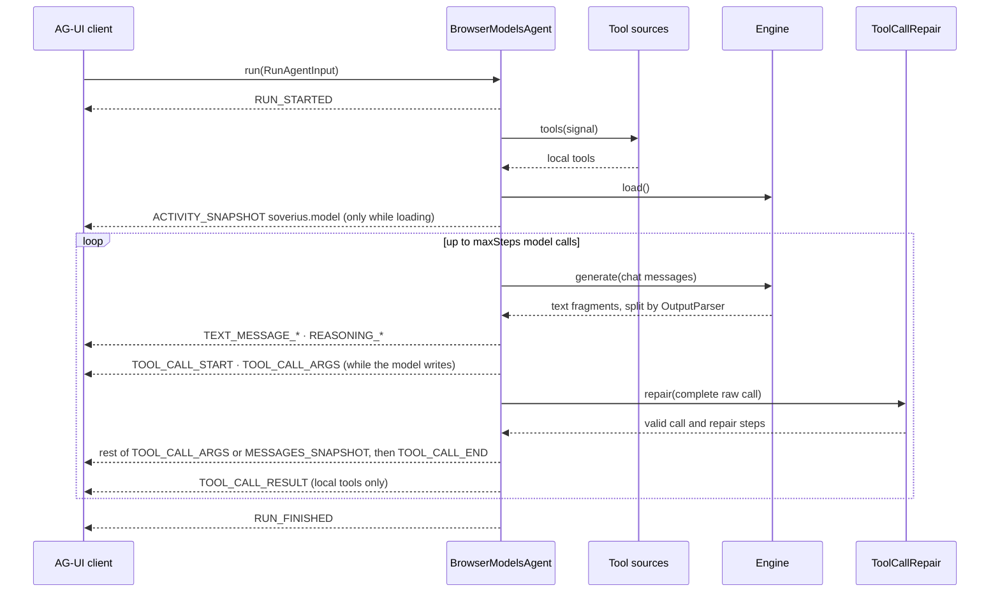
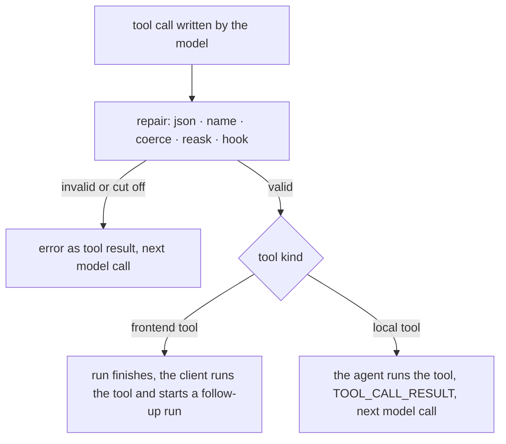
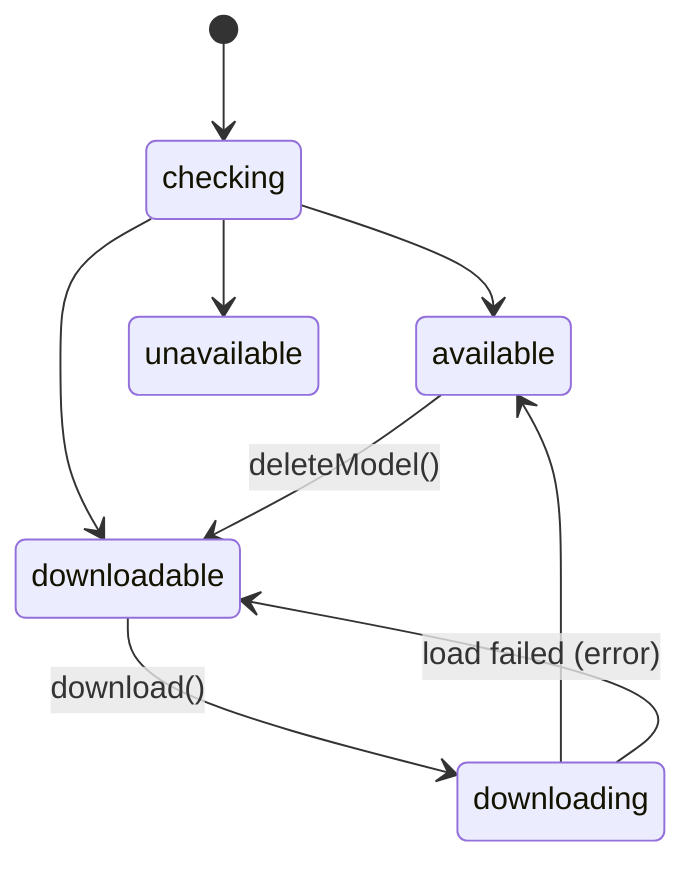

# Architecture

## Packages



The app creates the engines and tool sources and passes them to `BrowserModelsAgent`.

## One run



Event details: [Agent → Events](./agent.md#events), [Tools → Streaming](./tools.md#streaming).

## Tool calls



Frontend tools come from `RunAgentInput.tools`, local tools from `localTools`. See [Tools](./tools.md).

## Model state



`selectModel()` and `refresh()` start again at `checking`. See [Model state](./models.md).

## Repository

```text
libs/
  agent/browser-models      @soverius-ai/browser-models
  frameworks/angular        @soverius-ai/browser-models-angular
  frameworks/react          @soverius-ai/browser-models-react
  frameworks/vue            @soverius-ai/browser-models-vue
  examples/shared           private: demo engine, model list, example tools
apps/
  angular-copilotkit(-e2e)  CopilotKit Angular
  react-copilotkit(-e2e)    CopilotKit React
  vue-copilotkit(-e2e)      CopilotKit Vue
  vanilla-agui(-e2e)        plain @ag-ui/client, demo MCP server at /mcp
  docs                      this site; the examples are built into static/examples
Dockerfile                  nginx, port 8080, GET /health
```
