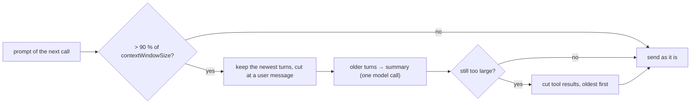

# Context

The context holds everything the model reads and writes in one call: system prompt, tool descriptions, conversation, tool results, reply.

| Engine          | Context size                                                                                              | Token counts after a call |
| --------------- | --------------------------------------------------------------------------------------------------------- | ------------------------- |
| Prompt API      | set by the browser, known from the first model call on                                                    | `session.contextUsage`    |
| WebLLM          | `contextWindowSize`, else `native.context_window_size`, else the model's build value (4096, 2048 or 1024) | `usage` of the last chunk |
| transformers.js | `contextWindowSize` (only the compaction budget)                                                          | its tokenizer             |

No context size known (a WebLLM model without a build value, transformers.js without `contextWindowSize`) or a negative one (WebLLM sliding window): nothing is compacted. The Prompt API's first call is never compacted: the size is known once the call has started its session.

The size estimate starts at 3 characters per token and then uses what the engine counted for the thread. Options and sizes: [Compaction](../agent/compaction.md).
