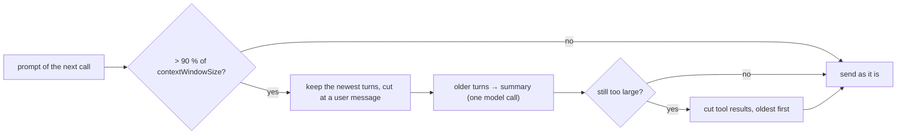

# Context

The context holds everything the model reads and writes in one call: system prompt, tool descriptions, conversation, tool results, reply.

| Engine          | Context size                                                    | Token counts after a call |
| --------------- | --------------------------------------------------------------- | ------------------------- |
| Prompt API      | set by the browser, known after the first answer                | `session.contextUsage`    |
| WebLLM          | `contextWindowSize`, else the model's build value (mostly 4096) | `usage` of the last chunk |
| transformers.js | `contextWindowSize` (only the compaction budget)                | its tokenizer             |

The size estimate starts at 3 characters per token and then uses what the engine counted for the thread. Options and sizes: [Compaction](../agent/compaction.md).
