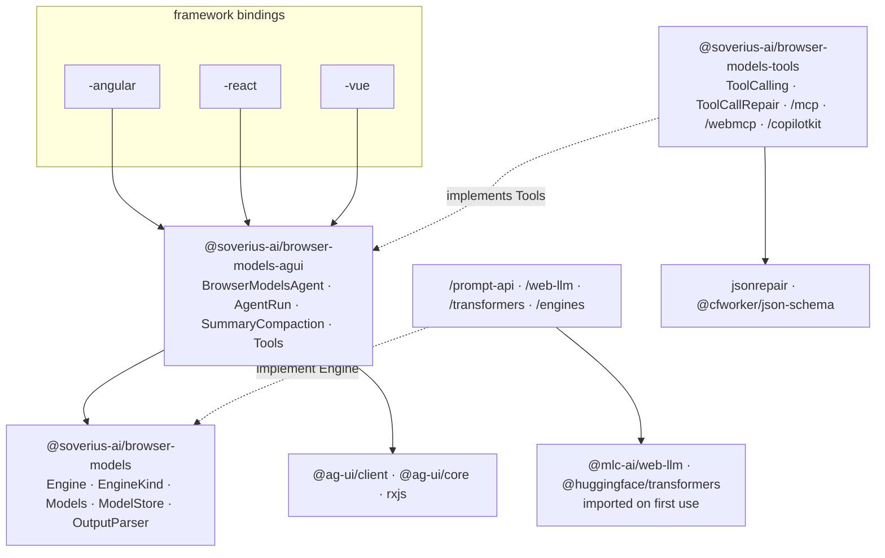

# Layers



## Packages

| Layer | Package                             | Contains                                                    | Dependencies                              | Bundle with the layers below (gzip) |
| ----- | ----------------------------------- | ----------------------------------------------------------- | ----------------------------------------- | ----------------------------------- |
| 1     | `@soverius-ai/browser-models`       | `Engine`, three engines, `Models`, `ModelStore`, parser     | none; engine libraries are optional peers | 2.1–5.2 KB                          |
| 2     | `@soverius-ai/browser-models-agui`  | `BrowserModelsAgent`, `AgentRun`, compaction, `AgentEvents` | `@ag-ui/client`, `@ag-ui/core`, `rxjs`    | 7.1 KB                              |
| 3     | `@soverius-ai/browser-models-tools` | `ToolCalling`, repair, schema checks, MCP, WebMCP, gen. UI  | `jsonrepair`, `@cfworker/json-schema`     | 20.4 KB                             |
| –     | `-angular`, `-react`, `-vue`        | model state and devtools for the framework                  | the framework                             | –                                   |

Sizes: esbuild, minified and gzipped, AG-UI not counted (CopilotKit brings it). Layer 1: the Prompt API engine and `ModelStore` (2.1 KB) up to all three engines (5.2 KB); layers 2 and 3 with the Prompt API engine.

## Rules

| Rule                                                            | Why                                                                                                                     |
| --------------------------------------------------------------- | ----------------------------------------------------------------------------------------------------------------------- |
| a layer imports only the layers below it                        | Nx tags `type:core` ← `type:agent` ← `type:tools`, checked by lint                                                      |
| the core has no dependencies                                    | a plain chat stays small                                                                                                |
| each engine has its own entry point                             | an app installs only the engine libraries it uses; Vite fails on missing ones                                           |
| engine libraries are imported on first use                      | WebLLM and transformers.js are not in the initial bundle                                                                |
| the app picks the model; nothing falls back                     | `availability()` tells, the app decides ([Choose an engine](../engines/index.md))                                       |
| the agent and tool calling are plug-ins (`tools`, `compaction`) | replace them with your own: [Custom Tools](../tools/custom.md), [Compaction](../agent/compaction.md#your-own-algorithm) |
| all packages share one version                                  | released together; peers are pinned to that version                                                                     |

## Repository

```text
libs/agent/browser-models        layer 1
libs/agent/browser-models-agui   layer 2
libs/agent/browser-models-tools  layer 3
libs/frameworks/*                Angular, React, Vue
libs/examples/shared             private: demo engine, model list, example tools
apps/engine-chat                 example: layer 1
apps/agent-chat                  example: layers 1–2
apps/*-copilotkit, vanilla-agui  examples: all layers
apps/docs-assistant              example: these docs, asked by a model in your browser
apps/docs                        this site
```

More: [A run](./run.md) · [Tool calls](./tool-calls.md) · [Context](./context.md) · [Model lifecycle](./model-lifecycle.md)
