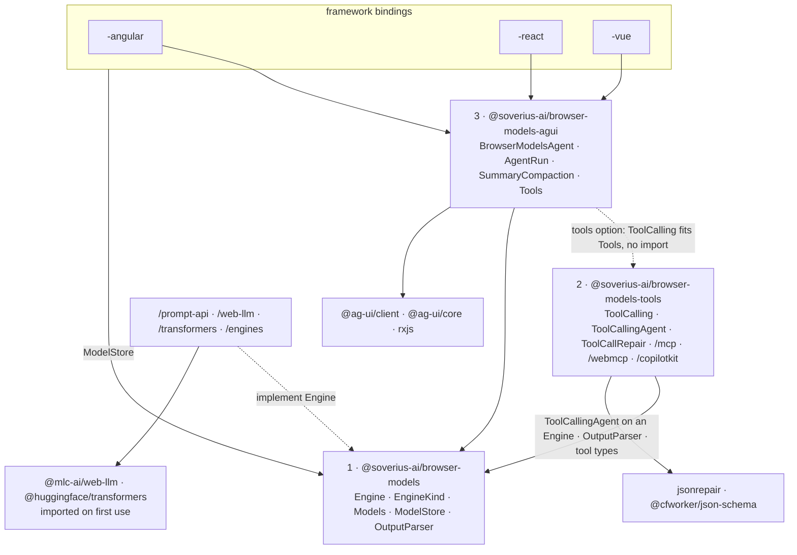

# How it works

The layers in detail: what each package holds and the rules between them. Then: [A run](./run.md) · [Tool calls](./tool-calls.md) · [Context](./context.md) · [Model lifecycle](./model-lifecycle.md)



## Packages

| Layer | Package                             | Contains                                                                | Dependencies                                                      | Bundle with the layers below (gzip) |
| ----- | ----------------------------------- | ----------------------------------------------------------------------- | ----------------------------------------------------------------- | ----------------------------------- |
| 1     | `@soverius-ai/browser-models`       | `Engine`, three engines, `Models`, `ModelStore`, parser, tool types     | none; engine libraries are optional peers                         | 2.1–5.2 KB                          |
| 2     | `@soverius-ai/browser-models-tools` | `ToolCalling`, `ToolCallingAgent`, repair, checks, MCP, WebMCP, gen. UI | `jsonrepair`, `@cfworker/json-schema`; `/copilotkit`: AG-UI peers | 16.3 KB (`ToolCallingAgent`)        |
| 3     | `@soverius-ai/browser-models-agui`  | `BrowserModelsAgent`, `AgentRun`, compaction, `AgentEvents`             | peers: `@ag-ui/client`, `@ag-ui/core` 1.x, `rxjs` 7               | 6.9 KB without tools, 21.4 KB with  |
| –     | `-angular`, `-react`, `-vue`        | model state and devtools for the framework                              | the framework                                                     | –                                   |

Sizes: the published packages bundled with esbuild, minified and gzipped, AG-UI not counted (CopilotKit brings it; bundled it adds about 76 KB). Layer 1: the Prompt API engine and `ModelStore` (2.1 KB) up to all three engines (5.2 KB); `ToolCallingAgent` on the Prompt API engine 16.3 KB; the AG-UI agent on it 6.9 KB, with `ToolCalling` 21.4 KB. `/mcp` adds 1.5 KB, `/copilotkit` 1.8 KB, `/webmcp` 0.4 KB. AG-UI and `rxjs` are peers, so the agent uses the app's copy, the one CopilotKit brings ([npm note](../agent/index.md)). The packages ship minified (esbuild); their type declarations keep the doc comments.

## Rules

| Rule                                                             | Why                                                                                                                                     |
| ---------------------------------------------------------------- | --------------------------------------------------------------------------------------------------------------------------------------- |
| a layer imports only the layers below it                         | Nx tags `type:core` ← `type:tools` ← `type:agent`, checked by lint                                                                      |
| the core needs no engine library                                 | a plain chat stays small                                                                                                                |
| each engine has its own entry point                              | an app installs only the engine libraries it uses; Vite fails on missing ones                                                           |
| engine libraries are imported on first use                       | WebLLM and transformers.js are not in the initial bundle; WebLLM runs in the package's worker                                           |
| the app picks the model; nothing falls back                      | `availability()` tells, the app decides ([Choose an engine](../engines/index.md))                                                       |
| tool calling needs no agent                                      | `ToolCallingAgent` runs on an engine, no AG-UI; the tool types are in the core ([ToolCallingAgent](../tools/index.md#toolcallingagent)) |
| tool calling and compaction are plug-ins (`tools`, `compaction`) | replace them with your own: [Custom Tools](../tools/custom.md), [Compaction](../agent/compaction.md#your-own-algorithm)                 |
| all packages share one version                                   | released together; peers are pinned to that version                                                                                     |

## Repository

```text
libs/agent/browser-models        layer 1
libs/agent/browser-models-tools  layer 2
libs/agent/browser-models-agui   layer 3
libs/frameworks/*                Angular, React, Vue
libs/examples/shared             private: demo engine, model list, example tools
libs/examples/snippets           private: the code on the front page and in the docs, tested
apps/engine-chat                 example: layer 1
apps/agent-chat                  example: layers 1 and 3
apps/*-copilotkit, vanilla-agui  examples: all layers
apps/docs-assistant              example: these docs, asked by a model in your browser
apps/docs                        this site
```
