# Model lifecycle

```mermaid
stateDiagram-v2
  [*] --> checking
  checking --> available
  checking --> downloadable
  checking --> unavailable
  downloadable --> downloading: download()
  downloading --> checking: done or failed (refresh; a failure also sets error)
  available --> downloadable: deleteModel()
```

| `Availability` | Prompt API                                    | WebLLM, transformers.js   |
| -------------- | --------------------------------------------- | ------------------------- |
| `available`    | the browser has the model                     | the files are cached      |
| `downloadable` | the browser can download it (user gesture)    | not cached yet            |
| `downloading`  | the browser downloads it                      | this page loads it        |
| `unavailable`  | no Prompt API, device or language unsupported | no WebGPU (WebGPU device) |

- `selectModel()` and `refresh()` of `ModelStore` start again at `checking`.
- Selecting another model unloads the previous one: models take gigabytes of GPU memory.
- `unload()` keeps the files; `delete()` removes them (not for the Prompt API: the browser owns the model).

API: [Model picker & downloads](../engines/models.md).
