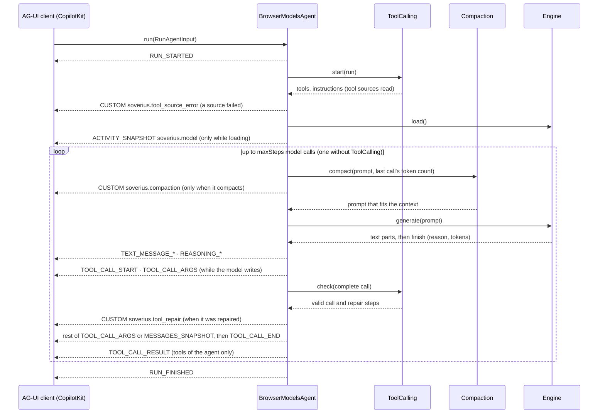

# A run

| Step                    | Ends the run when                                         |
| ----------------------- | --------------------------------------------------------- |
| a reply without a call  | always                                                    |
| a call to a client tool | always: the client runs it and starts a follow-up run     |
| a call to an agent tool | never: the result goes back to the model in the next step |
| `maxSteps` reached      | always                                                    |
| stop or error           | `RUN_ERROR` (`code: 'abort'` when stopped)                |

The client keeps the conversation; the agent gets it with every run. Event list: [Events](../agent/events.md).
