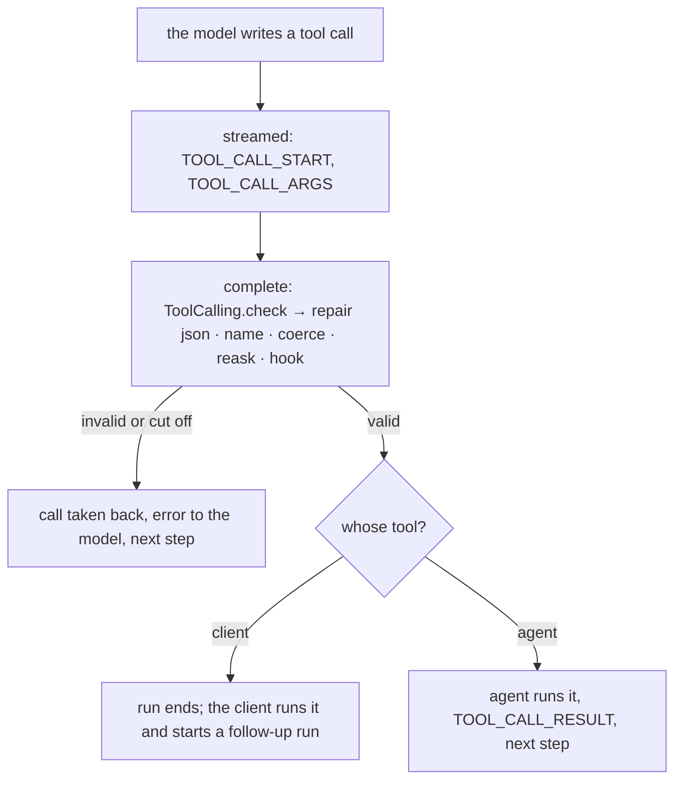

# Tool calls



| When                              | Events                                                                |
| --------------------------------- | --------------------------------------------------------------------- |
| name complete, tool known         | `TOOL_CALL_START` (repaired name)                                     |
| arguments arrive                  | `TOOL_CALL_ARGS` deltas                                               |
| output done, repair changed none  | `TOOL_CALL_ARGS` (the rest), `TOOL_CALL_END`                          |
| repair changed name or arguments  | `CUSTOM` `soverius.tool_repair`, `MESSAGES_SNAPSHOT`, `TOOL_CALL_END` |
| not repairable, cut off, or abort | `MESSAGES_SNAPSHOT` (call removed), `TOOL_CALL_END`                   |

```text
clean      START  ARGS {"city":"Vie  ARGS nna"  ARGS }                 END
repaired   START  ARGS {"days":"3"   CUSTOM  MESSAGES_SNAPSHOT {"days":3}  END
```

- At `TOOL_CALL_END` the client holds the repaired call: joined deltas, or the snapshot.
- `MESSAGES_SNAPSHOT` = the run's input messages + this run's messages. AG-UI has no event to take back sent arguments.
- Unknown tool name: nothing is streamed.

Details: [Repair & streaming](../tools/repair.md).
