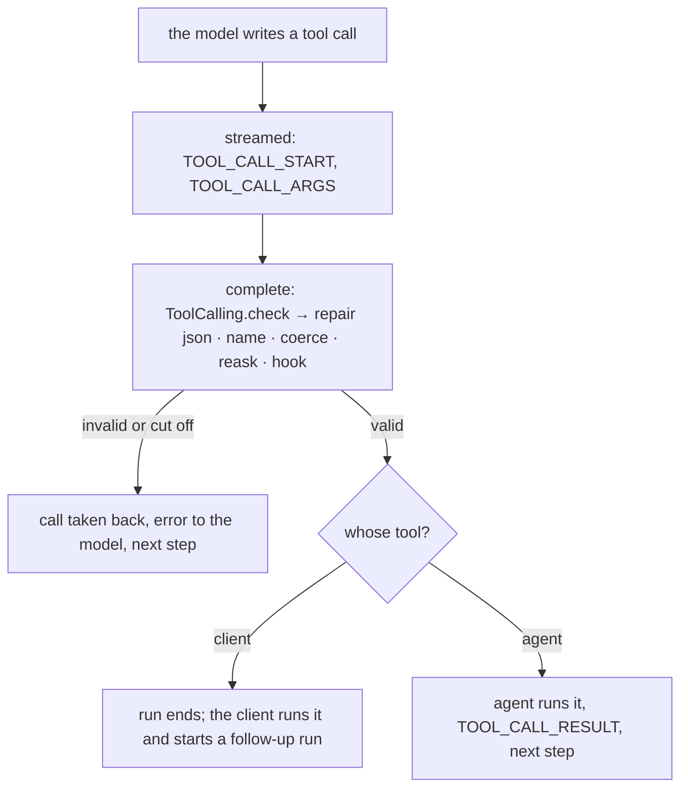

# Tool calls



| When                                                    | Events                                                                            |
| ------------------------------------------------------- | --------------------------------------------------------------------------------- |
| name complete, tool known                               | `TOOL_CALL_START` (repaired name)                                                 |
| arguments arrive                                        | `TOOL_CALL_ARGS` deltas                                                           |
| call complete, any repair step                          | `CUSTOM` `soverius.tool_repair` with the steps                                    |
| call complete, not streamed before                      | `TOOL_CALL_START` (after the `CUSTOM` event)                                      |
| what was sent is the start of the repaired call         | `TOOL_CALL_ARGS` (the rest), `TOOL_CALL_END`                                      |
| streamed, and the name or the sent arguments changed    | `MESSAGES_SNAPSHOT`, `TOOL_CALL_END`                                              |
| not repairable, cut off, stop or error, after streaming | `MESSAGES_SNAPSHOT` (call removed); the error goes to the model if steps are left |

```text
clean      START  ARGS {"city":"Vie  ARGS nna"  ARGS }                 END
repaired   START  ARGS {"days":"3"   CUSTOM  MESSAGES_SNAPSHOT {"days":3}  END
```

- At `TOOL_CALL_END` the client holds the repaired call: joined deltas, or the snapshot.
- `MESSAGES_SNAPSHOT` = the run's input messages + this run's messages. AG-UI has no event to take back sent arguments.
- Unknown tool name: nothing is streamed. Names are matched exactly, then without a prefix (`functions.`, `default_api.`), `()`, case and separators, then with one typo. A name that still matches no tool goes back to the model as an error listing the tool names, while steps are left.
- The instructions show a real call of the first tool, with example arguments from its schema: small models copy a placeholder such as `<tool name>` as it is.

Details: [Repair & streaming](../tools/repair.md).
