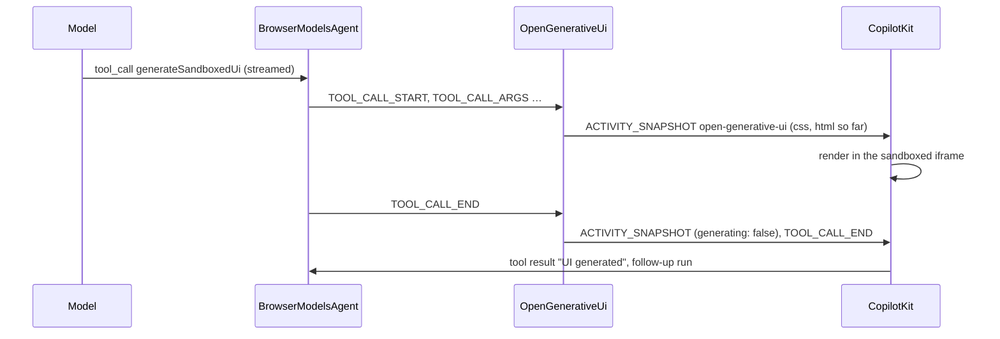

# Generative UI

The model calls a tool, and the chat shows a component instead of text. Both kinds work with CopilotKit and streamed tool calls.

| Kind                  | Who writes the UI | How                                                                                 |
| --------------------- | ----------------- | ----------------------------------------------------------------------------------- |
| Tool with a component | you               | a frontend tool with a `render` (or `component`); the model fills in the arguments  |
| Open Generative UI    | the model         | the model writes HTML, CSS and JavaScript; CopilotKit runs it in a sandboxed iframe |

## Tool with a component

Register a frontend tool and give it a component. The component gets the arguments while they stream.

| Framework | API                                      | Details                                      |
| --------- | ---------------------------------------- | -------------------------------------------- |
| Angular   | `registerFrontendTool({ …, component })` | [Angular](./angular.md#streaming-tool-calls) |
| React     | `useFrontendTool({ …, render })`         | [React](./react.md#streaming-tool-calls)     |
| Vue       | `useFrontendTool({ …, render })`         | [Vue](./vue.md#streaming-tool-calls)         |

```tsx
useFrontendTool(
  {
    name: 'getWeather',
    description: 'Get the weather for a city',
    parameters: z.object({ city: z.string() }),
    handler: async ({ city }) => ({ city, temperature: 21 }),
    render: ({ args, status }) => (
      <div data-status={status}>Weather in {args.city ?? '…'}</div>
    ),
  },
  [],
);
```

Nothing else to set up: the agent emits the call, CopilotKit runs the tool and starts the follow-up run.

## Open Generative UI

CopilotKit's Open Generative UI: the model calls `generateSandboxedUi`, and CopilotKit shows the result in a sandboxed iframe ([`@jetbrains/websandbox`](https://github.com/JetBrains/websandbox)). Two steps.

### 1. Agent

```ts
import { BrowserModelsAgent } from '@soverius-ai/browser-models/agent';
import { OpenGenerativeUi } from '@soverius-ai/browser-models/copilotkit';

const agent = new BrowserModelsAgent({ models, defaultModel: 'gemma' });
agent.use(new OpenGenerativeUi());
```

`OpenGenerativeUi` is an AG-UI middleware. While the tool call streams, it reports what has arrived as `open-generative-ui` activity messages, which CopilotKit renders. CopilotKit's server runtime normally does this; an agent in the browser has no runtime.

### 2. CopilotKit

Set `openGenerativeUI` on the provider. It registers the `generateSandboxedUi` tool, its design guidelines for the model, and the sandbox renderer.

```ts
// Angular
provideCopilotKit({ agents: { default: agent }, openGenerativeUI: {} });
```

```tsx
// React
<CopilotKitProvider
  agents__unsafe_dev_only={{ default: agent }}
  openGenerativeUI={{}}
>
  <CopilotChat />
</CopilotKitProvider>
```

```vue
<!-- Vue: pass it with v-bind. Vue reads `open-generative-ui` as `openGenerativeUi`. -->
<script setup lang="ts">
const sandbox = { openGenerativeUI: {} };
</script>

<template>
  <CopilotKitProvider :agents__unsafe_dev_only="agents" v-bind="sandbox">
    <CopilotChat />
  </CopilotKitProvider>
</template>
```

| Option             | Type                                           | Purpose                                            |
| ------------------ | ---------------------------------------------- | -------------------------------------------------- |
| `sandboxFunctions` | `{ name, description, parameters, handler }[]` | functions of your page the generated code may call |
| `designSkill`      | `string`                                       | your own design guidelines for the model           |

Generated code calls a sandbox function with `Websandbox.connection.remote.<name>(args)`.

### What the model writes

The arguments of `generateSandboxedUi`, in this order:

| Parameter             | Type       | Shown                                                                         |
| --------------------- | ---------- | ----------------------------------------------------------------------------- |
| `initialHeight`       | `number`   | height of the frame while the page is generated                               |
| `placeholderMessages` | `string[]` | texts while the page is generated                                             |
| `css`                 | `string`   | applied when complete                                                         |
| `html`                | `string`   | live, while the model writes it; `<script src>` may load libraries from a CDN |
| `jsFunctions`         | `string`   | helper functions, defined when complete                                       |
| `jsExpressions`       | `string[]` | run one by one after the HTML is ready, for example `initializeChart()`       |

The sandbox has no access to your page: no cookies, no storage, no same-origin requests.

### Flow



The model writes a whole page as tool arguments, so use the largest model you offer and give it room:

- WebLLM defaults to 4096 tokens. Set `contextWindowSize: 16384` ([Context size](./engines.md#context-size)).
- Small models follow a short `designSkill` with one exact pattern better than CopilotKit's long default. See `sandboxDesignSkill` in `libs/examples/shared/src/lib/sandbox-demos.ts`.

Try it: [Playground](/playground?platform=angular), "Draw a chart with Chart.js" or "Build a tip calculator". Examples: `apps/angular-copilotkit`, `apps/react-copilotkit`, `apps/vue-copilotkit`.
