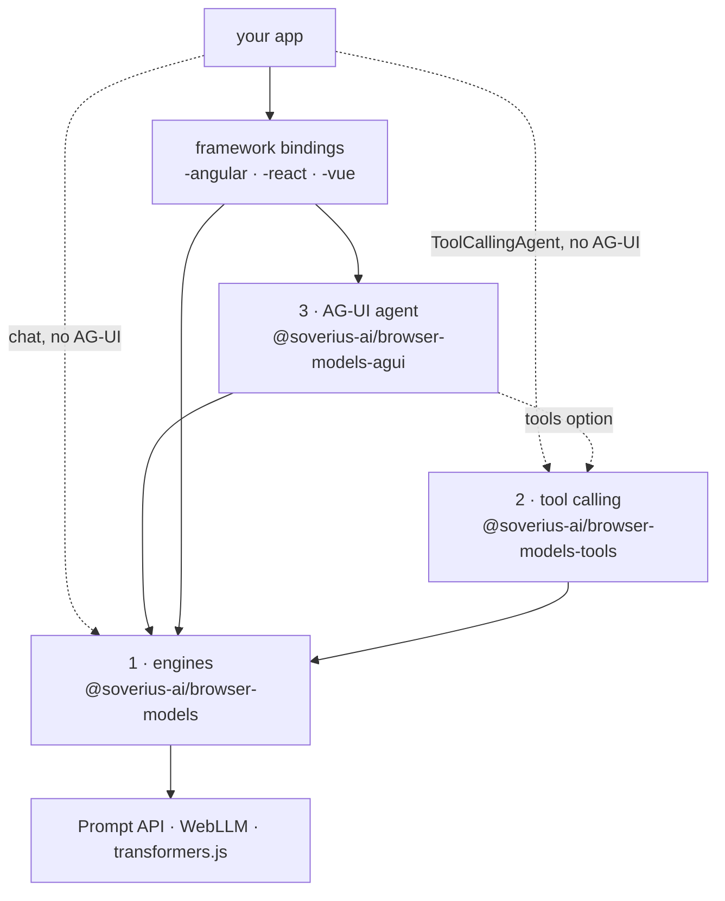

# browser-models

Language models that run in the browser, in three layers. Start with the first, add the next when you need it.



| You build                                  | Install                                          | Start with                            |
| ------------------------------------------ | ------------------------------------------------ | ------------------------------------- |
| a chat on a model in the browser, no AG-UI | `browser-models`                                 | [Engines](./engines/index.md)         |
| tool calls on an engine, no AG-UI          | add `browser-models-tools`                       | [Tools](./tools/index.md)             |
| a CopilotKit or AG-UI chat                 | `browser-models` + `browser-models-agui`         | [Agent](./agent/index.md)             |
| the same with tools, MCP, WebMCP, gen. UI  | add `browser-models-tools`                       | [Tools](./tools/index.md)             |
| Angular, React or Vue                      | add `browser-models-angular`, `-react` or `-vue` | [Frameworks](./frameworks/angular.md) |

## Engines

| Engine          | Class                  | Runs on                                 | Model storage              |
| --------------- | ---------------------- | --------------------------------------- | -------------------------- |
| Prompt API      | `PromptApiEngine`      | Chrome (Gemini Nano), Edge (Phi-4-mini) | the browser                |
| WebLLM          | `WebLlmEngine`         | WebGPU, in a Web Worker                 | Cache API (default) · OPFS |
| transformers.js | `TransformersJsEngine` | WebGPU or WASM                          | Cache API (default) · OPFS |

## Install

```bash
pnpm add @soverius-ai/browser-models
pnpm add @soverius-ai/browser-models-tools               # tool calling
pnpm add @soverius-ai/browser-models-agui                # AG-UI agent
pnpm add @ag-ui/client zod                               # only without CopilotKit
pnpm add @mlc-ai/web-llm                                 # only for WebLlmEngine
pnpm add @huggingface/transformers                       # only for TransformersJsEngine
```

Each snippet below is a whole `main.ts`: it runs as it is in Chrome with Gemini Nano, and in CI against a scripted model.

## 1 · Chat on an engine

```ts title="libs/examples/snippets/src/chat.ts"
import { PromptApiEngine } from '@soverius-ai/browser-models/prompt-api';

// Layer 1: an engine. The model built into the browser: Gemini Nano in Chrome.
const engine = new PromptApiEngine();
const output = document.body.appendChild(document.createElement('p'));

if ((await engine.availability()) === 'unavailable') {
  output.textContent = 'This browser has no Prompt API.';
} else {
  for await (const part of engine.generate({
    messages: [{ role: 'user', content: 'Write a haiku about the browser.' }],
  }))
    if (part.type === 'text') output.append(part.text);
}
```

## 2 · Tools on an engine

```ts title="libs/examples/snippets/src/engine-tools.ts"
import { PromptApiEngine } from '@soverius-ai/browser-models/prompt-api';
import {
  ToolCallingAgent,
  type LocalTool,
} from '@soverius-ai/browser-models-tools';

// Layer 2: tool calling on the engine, no AG-UI. ToolCallingAgent runs the tool and keeps the chat.
const currentTime: LocalTool = {
  name: 'currentTime',
  description: 'Returns the current local time.',
  parameters: { type: 'object', properties: {} },
  execute: async () => new Date().toLocaleTimeString(),
};

const agent = new ToolCallingAgent({
  engine: new PromptApiEngine(),
  localTools: [currentTime],
});
const output = document.body.appendChild(document.createElement('p'));

for await (const part of agent.run('What time is it?')) {
  if (part.type === 'tool-call') output.append(`[${part.call.name}] `);
  if (part.type === 'text') output.append(part.text);
}
```

## 3 · An AG-UI agent

```ts title="libs/examples/snippets/src/agent.ts"
import { PromptApiEngine } from '@soverius-ai/browser-models/prompt-api';
import { BrowserModelsAgent } from '@soverius-ai/browser-models-agui';

// Layer 3: an AG-UI agent on the engine. Any AG-UI client runs it; here its own runAgent.
const agent = new BrowserModelsAgent({
  models: { nano: new PromptApiEngine() },
  defaultModel: 'nano',
});
const output = document.body.appendChild(document.createElement('p'));

agent.addMessage({
  id: crypto.randomUUID(),
  role: 'user',
  content: 'Explain AG-UI in one sentence.',
});
await agent.runAgent(
  {},
  { onTextMessageContentEvent: ({ event }) => void output.append(event.delta) },
);
```

### With tools

```ts title="libs/examples/snippets/src/tools.ts"
import { PromptApiEngine } from '@soverius-ai/browser-models/prompt-api';
import { BrowserModelsAgent } from '@soverius-ai/browser-models-agui';
import { ToolCalling, type LocalTool } from '@soverius-ai/browser-models-tools';

// Layer 3 with layer 2: the AG-UI agent with tool calling. It runs the tool, the model answers.
const currentTime: LocalTool = {
  name: 'currentTime',
  description: 'Returns the current local time.',
  parameters: { type: 'object', properties: {} },
  execute: async () => new Date().toLocaleTimeString(),
};

const agent = new BrowserModelsAgent({
  models: { nano: new PromptApiEngine() },
  defaultModel: 'nano',
  tools: new ToolCalling({ localTools: [currentTime] }),
});
const output = document.body.appendChild(document.createElement('p'));

agent.addMessage({
  id: crypto.randomUUID(),
  role: 'user',
  content: 'What time is it?',
});
await agent.runAgent(
  {},
  {
    onToolCallStartEvent: ({ event }) =>
      void output.append(`[${event.toolCallName}] `),
    onTextMessageContentEvent: ({ event }) => void output.append(event.delta),
  },
);
```

## CopilotKit

```tsx title="libs/examples/snippets/src/copilotkit.tsx"
import {
  CopilotChat,
  CopilotKitProvider,
  useFrontendTool,
} from '@copilotkit/react-core/v2';
import '@copilotkit/react-core/v2/styles.css';
import { PromptApiEngine } from '@soverius-ai/browser-models/prompt-api';
import { BrowserModelsAgent } from '@soverius-ai/browser-models-agui';
import { ToolCalling } from '@soverius-ai/browser-models-tools';
import { createRoot } from 'react-dom/client';
import { z } from 'zod';

// CopilotKit, unmodified: it talks AG-UI, the agent runs the model in the browser.
const agent = new BrowserModelsAgent({
  models: { nano: new PromptApiEngine() },
  defaultModel: 'nano',
  tools: new ToolCalling(),
});

// A frontend tool: the model calls it, it runs in the page.
function Background() {
  useFrontendTool(
    {
      name: 'setBackground',
      description: 'Sets the background color of the page.',
      parameters: z.object({ color: z.string() }),
      handler: async ({ color }) => {
        document.body.style.background = color;
        return `The background is ${color}.`;
      },
    },
    [],
  );
  return null;
}

createRoot(document.getElementById('root') as HTMLElement).render(
  <CopilotKitProvider agents__unsafe_dev_only={{ default: agent }}>
    <Background />
    <CopilotChat />
  </CopilotKitProvider>,
);
```

Next: [Engines](./engines/index.md) · [Examples](./examples/index.md) · [Playground](/playground) · [How it works](./architecture/index.md) · [API reference](./api/browser-models/index.md)
