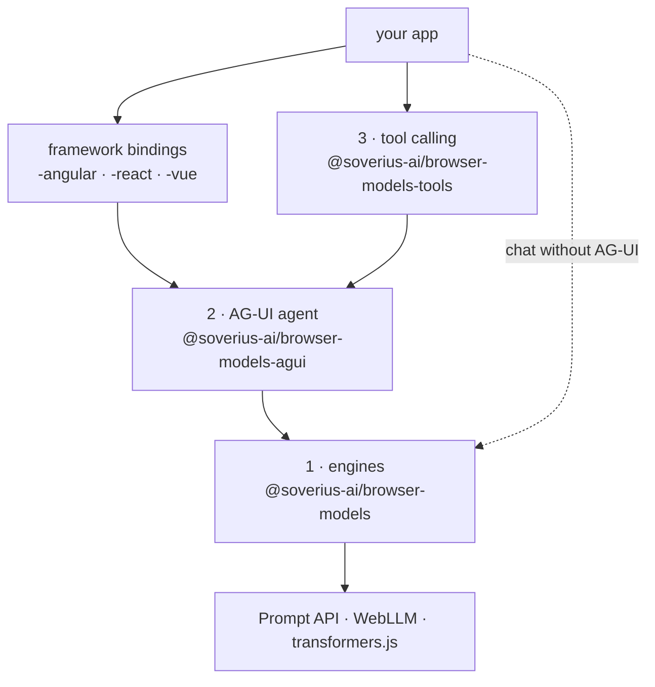

# browser-models

Language models that run in the browser, in three layers. Take only the layers you need.



| You build                                       | Install                                          | Start with                            |
| ----------------------------------------------- | ------------------------------------------------ | ------------------------------------- |
| a chat on a model in the browser, no AG-UI      | `browser-models`                                 | [Engines](./engines/index.md)         |
| a CopilotKit or AG-UI chat                      | `browser-models` + `browser-models-agui`         | [Agent](./agent/index.md)             |
| the same with tools, MCP, WebMCP, generative UI | add `browser-models-tools`                       | [Tools](./tools/index.md)             |
| Angular, React or Vue                           | add `browser-models-angular`, `-react` or `-vue` | [Frameworks](./frameworks/angular.md) |

## Engines

| Engine          | Class                  | Runs on                                 | Model storage              |
| --------------- | ---------------------- | --------------------------------------- | -------------------------- |
| Prompt API      | `PromptApiEngine`      | Chrome (Gemini Nano), Edge (Phi-4-mini) | the browser                |
| WebLLM          | `WebLlmEngine`         | WebGPU                                  | Cache API (default) · OPFS |
| transformers.js | `TransformersJsEngine` | WebGPU or WASM                          | Cache API (default) · OPFS |

## Install

```bash
pnpm add @soverius-ai/browser-models
pnpm add @soverius-ai/browser-models-agui      # AG-UI agent
pnpm add @soverius-ai/browser-models-tools     # tool calling
pnpm add @mlc-ai/web-llm                       # only for WebLlmEngine
pnpm add @huggingface/transformers             # only for TransformersJsEngine
```

## Layer 1: chat on an engine

```ts
import { PromptApiEngine } from '@soverius-ai/browser-models/prompt-api';

const engine = new PromptApiEngine();
for await (const part of engine.generate({
  messages: [{ role: 'user', content: 'Hi' }],
}))
  if (part.type === 'text') output.textContent += part.text;
```

## Layer 2: an AG-UI agent for CopilotKit

```tsx
import { CopilotChat, CopilotKitProvider } from '@copilotkit/react-core/v2';
import { BrowserModelsAgent } from '@soverius-ai/browser-models-agui';

const agent = new BrowserModelsAgent({
  models: { nano: new PromptApiEngine() },
  defaultModel: 'nano',
});

<CopilotKitProvider agents__unsafe_dev_only={{ default: agent }}>
  <CopilotChat />
</CopilotKitProvider>;
```

## Layer 3: tools

```ts
import { ToolCalling } from '@soverius-ai/browser-models-tools';
import { McpTools } from '@soverius-ai/browser-models-tools/mcp';

const agent = new BrowserModelsAgent({
  models: { nano: new PromptApiEngine() },
  defaultModel: 'nano',
  tools: new ToolCalling({
    localTools: [new McpTools({ url: 'https://example.com/mcp' })],
  }),
});
```

Next: [Architecture](./architecture/index.md) · [Examples](./examples/index.md) · [API reference](./api/browser-models/index.md) · [Playground](/playground)
